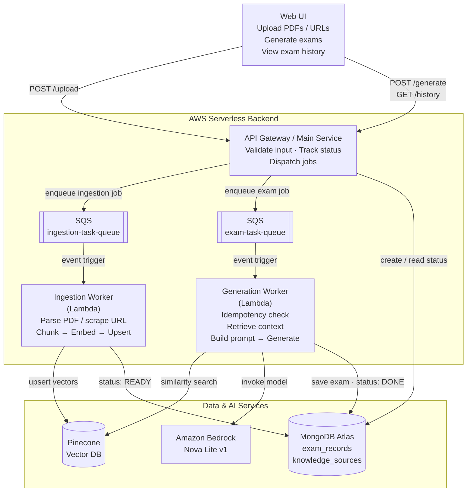

# 🎓 AI-Powered Exam Paper Generator

A sophisticated full-stack Spring Boot application that utilizes **RAG (Retrieval-Augmented Generation)** to transform personal PDF notes into structured school exam papers. This project features a distributed architecture, offloading heavy AI computation to a dedicated local server.

---

## 🧠 System Architecture & Workflow
The project is built on the principle of **Retrieval-Augmented Generation (RAG)**. Instead of relying on a model's general knowledge, it "retrieves" your specific notes to "augment" the AI's generation.

### 1. Ingestion (The Library)
* **PDF Processing:** Documents are parsed and broken into smaller text "chunks".
* **Vector Embeddings:** Text is converted into mathematical vectors using the `nomic-embed-text` model on a remote Windows PC.
* **Vector Storage:** These vectors are stored in **Pinecone**, organized by Subject and Class metadata for precise retrieval.

### 2. Retrieval & Generation (The Brain)
* **Similarity Search:** When an exam is requested, the system finds the most relevant chunks in Pinecone based on the chapter name.
* **Contextual Prompting:** The retrieved text is injected into a "Teacher Prompt" sent to **Llama 3.1**.
* **Execution:** The LLM generates questions (MCQs, Long Answers) and an Answer Key based *only* on the provided notes.

### 3. Storage & Export (The Archive)
* **MongoDB Atlas:** Every generated paper is saved to a cloud-hosted history log.
* **Professional PDF:** Uses **OpenPDF** to generate branded A4 documents with automated page breaks for the answer key.

---

## 🛠️ Tech Stack
| Component | Technology |
| :--- | :--- |
| **Framework** | Spring Boot 3.x, Spring AI |
| **AI Models** | Llama 3.1 (LLM), nomic-embed-text (Embeddings) |
| **Vector DB** | Pinecone |
| **Database** | MongoDB Atlas |
| **Cache / Queue** | Upstash Redis |
| **Compute / Hosting** | AWS Lambda (Container Image) with AWS Lambda Web Adapter |
| **Networking** | Tailscale (Secure Mesh VPN) |
| **Frontend** | Thymeleaf, Bootstrap 5 |
| **PDF Engine** | OpenPDF / LibrePDF |

---

## 🚀 Key Features
* **Distributed AI:** Seamlessly connects a MacBook client to a Windows AI server over any network via **Tailscale**.
* **Smart Subject Silos:** Metadata filtering ensures Physics questions only come from Physics notes.
* **Automated Answer Keys:** AI places answers at the end of the document after a strict delimiter.
* **Branded PDF Export:** Server-side PDF generation ensures consistent formatting with school logos.
* **Zero Idle Cost Architecture:** Hosted on AWS Lambda with a Function URL, scaling down to 0 instances when not in use.

---

## 📂 API Summary
* `GET /exams` - Access the main generator dashboard.
* `POST /api/exams/generate` - Trigger the AI pipeline and save to MongoDB.
* `GET /exams/history/results` - Search the Atlas database for past papers.
* `GET /api/pdf/download/{id}` - Generate and download the official PDF.

---

## 🌐 Live Access
* **Live Endpoint:** `https://2t2saofkd5ngmt7ahmrnaynujq0tutlw.lambda-url.ap-south-1.on.aws/exams`
* **Shorter URL: ** `https://bit.ly/papergenerator`

---

## 🐳 Docker Build & Deploy to AWS Lambda

Whenever you make code updates or enhancements, run this sequence to build the single-architecture container, push to Amazon ECR, and update the live Lambda function.

### 1. Authenticate Docker with ECR
```bash
aws ecr get-login-password --region ap-south-1 | docker login --username AWS --password-stdin 558260070804.dkr.ecr.ap-south-1.amazonaws.com
```

### 2. Build Multi-Stage Image (Provenance Disabled)
> **Note:** `--provenance=false` is strictly required to ensure Docker generates a single-manifest OCI image compatible with AWS Lambda.
```bash
docker buildx build \
  --platform linux/amd64 \
  --provenance=false \
  -t 558260070804.dkr.ecr.ap-south-1.amazonaws.com/paper-generation:latest \
  --load .
```

### 3. Push Image to ECR
```bash
docker push 558260070804.dkr.ecr.ap-south-1.amazonaws.com/paper-generation:latest
```

### 4. Deploy New Image to Lambda
> Simply pushing to ECR does not automatically reload Lambda. Run this command to tell Lambda to pull the new `:latest` digest:
```bash
aws lambda update-function-code \
  --function-name paper-generation-app \
  --image-uri 558260070804.dkr.ecr.ap-south-1.amazonaws.com/paper-generation:latest \
  --region ap-south-1
```

### 5. Tail CloudWatch Logs (Optional Debugging)
```bash
aws logs tail /aws/lambda/paper-generation-app --region ap-south-1 --follow
```

---

## ⚡ Automated Deployment Script (`deploy.sh`)

You can create an executable script in the root of your project to automate deployments:

```bash
#!/usr/bin/env bash
set -e

ACCOUNT_ID="558260070804"
REGION="ap-south-1"
REPO="paper-generation"
FUNCTION="paper-generation-app"
IMAGE_URI="${ACCOUNT_ID}.dkr.ecr.${REGION}.amazonaws.com/${REPO}:latest"

echo "🔐 Logging in to Amazon ECR..."
aws ecr get-login-password --region ${REGION} | docker login --username AWS --password-stdin ${ACCOUNT_ID}.dkr.ecr.${REGION}.amazonaws.com

echo "🔨 Building Docker image..."
docker buildx build --platform linux/amd64 --provenance=false -t ${IMAGE_URI} --load .

echo "📤 Pushing image to ECR..."
docker push ${IMAGE_URI}

echo "🚀 Updating Lambda function code..."
aws lambda update-function-code --function-name ${FUNCTION} --image-uri ${IMAGE_URI} --region ${REGION}

echo "✅ Deployment complete! Live at: https://2t2saofkd5ngmt7ahmrnaynujq0tutlw.lambda-url.ap-south-1.on.aws/exams"
```

To use it:
```bash
chmod +x deploy.sh
./deploy.sh
```

---

## 🗺️ Roadmap
- [ ] **Smart Subject Management:** Dashboard to manage and update note silos.
- [ ] **AI Grading Assistant:** Grade handwritten answers against stored keys.
- [ ] **User Auth:** Multi-teacher login support.


## Proposed Architecture Changes:

## Architecture

The system is a serverless, event-driven RAG pipeline on AWS. The API accepts requests and returns immediately. The slow work, ingesting documents and generating exams, runs asynchronously in SQS-triggered Lambda workers, and MongoDB Atlas tracks the status of every job.



### How it works

**1. Knowledge ingestion** (`POST /upload`)

1. The user uploads PDFs or URLs, tagged with topic, subject, class and chapters.
2. The main service validates the input, creates a `knowledge_sources` record with status `INDEXING`, and enqueues a job on `ingestion-task-queue`.
3. The **Ingestion Worker** parses the PDF bytes, or sanitizes and scrapes the URL with Jsoup.
4. The text is chunked, embedded, and upserted into Pinecone with `topicId`, `subject`, `className` and `chapter` as namespace/metadata.
5. The worker sets the source's status to `READY`.

**2. Exam generation** (`POST /generate`)

1. The user submits an exam-pattern prompt for a subject, class and set of chapters.
2. The main service creates an `exam_records` entry with status `GENERATING` and enqueues a job on `exam-task-queue`.
3. The **Generation Worker** checks MongoDB first and skips jobs that are already done, so a redelivered SQS message never produces a duplicate exam.
4. It retrieves the relevant chunks from Pinecone, filtered by the exam's metadata.
5. It assembles a structured prompt (generation rules + retrieved context) and calls **Amazon Bedrock (Nova Lite v1)**.
6. It saves the generated exam and sets the status to `DONE`. On success, Lambda's SQS integration deletes the message automatically.

**3. History** (`GET /history`)

The main service reads `exam_records`, so the UI can show each exam's content and status (`GENERATING` / `DONE`).

### Components

| Component | Technology | Responsibility |
|---|---|---|
| Main service | Amazon API Gateway | Validates input, writes job status, dispatches jobs to SQS |
| Job queues | Amazon SQS | `ingestion-task-queue` and `exam-task-queue` decouple the API from long-running work |
| Ingestion Worker | AWS Lambda | Parses PDFs, scrapes URLs (Jsoup), chunks text, generates embeddings, upserts vectors |
| Generation Worker | AWS Lambda | Retrieves context, builds the prompt, calls the LLM, stores the exam |
| Vector store | Pinecone | Stores chunk embeddings, scoped by topic, subject, class and chapter |
| Database | MongoDB Atlas | Stores exam records and knowledge-source status |
| LLM | Amazon Bedrock (Nova Lite v1) | Generates the exam from the prompt and retrieved context |

### Data model

| Collection | Fields | Status lifecycle |
|---|---|---|
| `exam_records` | `id`, `subject`, `class`, `chapters`, `pattern`, `content`, `status` | `GENERATING` → `DONE` |
| `knowledge_sources` | `topicId`, `urls`, `pdfNames`, `status` | `INDEXING` → `READY` |

### Design notes

- **Asynchronous by default.** Ingestion and generation can take far longer than an API request should, so the API only records the job and queues it. The UI checks progress through `GET /history`.
- **Idempotent workers.** SQS delivers messages at least once, so the Generation Worker checks MongoDB before doing any work.
- **Scoped retrieval.** Every vector carries topic, subject, class and chapter metadata, so the prompt only receives context from the chapters the exam covers.
